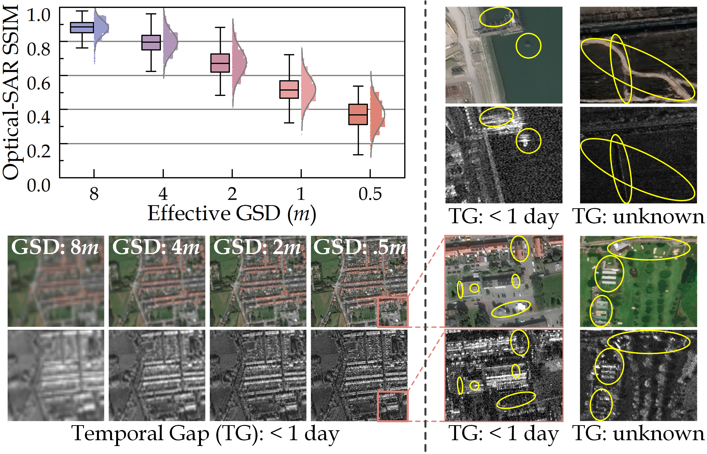
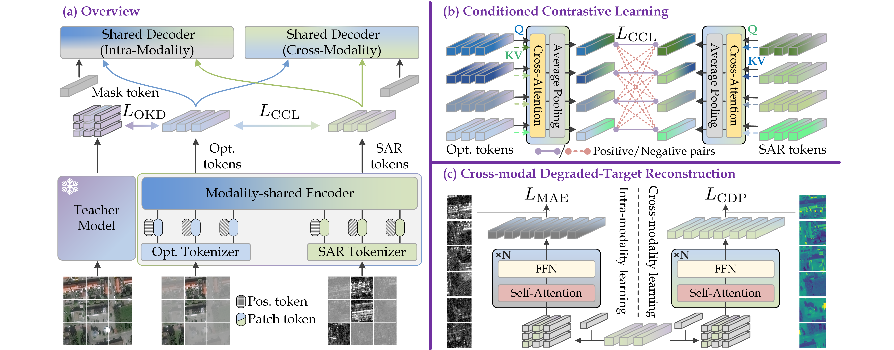
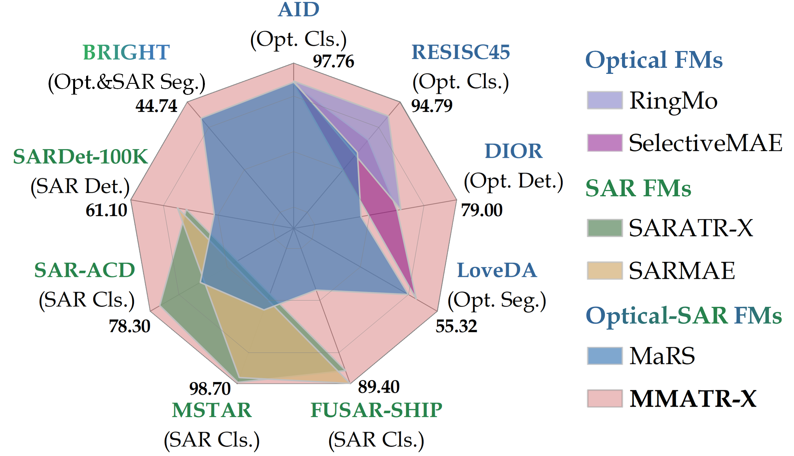
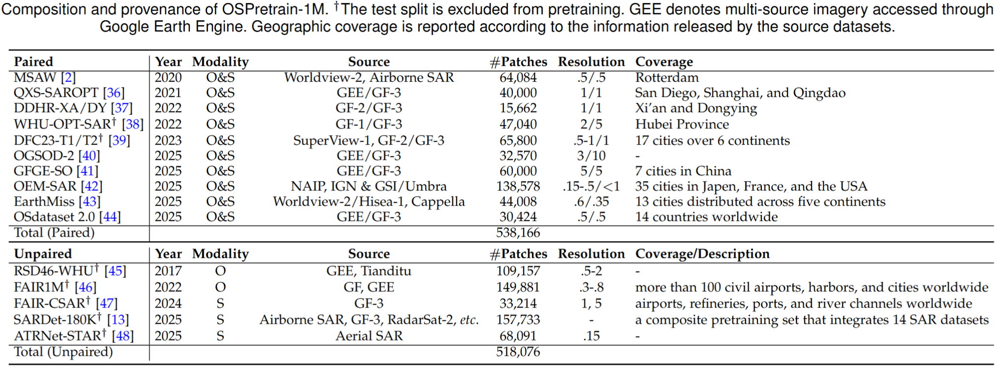
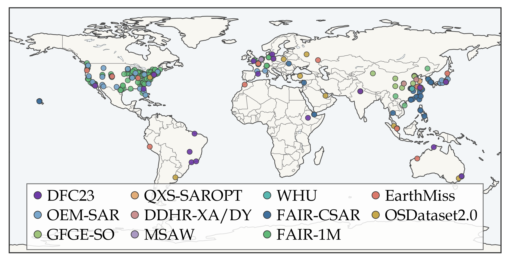

<h1 align="center"> MMATR-X: High-Resolution Optical-SAR Joint Pretraining via Conditioned Alignment and Degraded-Target Prediction

<h5 align="center"><em> Bowen Peng, Yongxiang Liu, Jie Zhou, Xiaodong Chen, Tianpeng Liu, Xiaogang Yu, and Li Liu </em></h5>

<p align="center">
  <a href="#Introduction">📖 Introduction</a> |
  <a href="#Pre-training">⚙️ Pre-training</a> |
  <a href="#Classification">📊 Classification</a> |
  <a href="#Segmentation">🧩 Segmentation</a> |
  <a href="#Detection">🎯 Detection</a> |
  <a href="#Statement">📜 Statement</a>
</p>

<p align="center">
  <a href="https://arxiv.org/abs/2604.16952"></a>
  <a href="https://github.com/scenarri/CoDeMAE"></a>
  <a href="https://pan.baidu.com/s/1MNFYW0sU5Nkla67Aw0EL3g?pwd=vkpg"></a>
</p>

> <b>Note</b>: We are currently working on a revision and refactoring this repository. We will share the resources again at a later date.


## Introduction

Multimodal pretraining aims to exploit complementary information across different sensing modalities. For optical and SAR imagery, however, cross-modal correspondence is only partial and varies across spatial scales and observation pairs. As shown below, finer spatial resolution exposes increasingly modality-specific details, while pair-specific conditions further change the degree and form of correspondence.
<p align="center">
  
</p>
<div align="center"> <b>Fig. 1</b> | Optical-SAR correspondence varies with both spatial scale and individual observation pairs.
</div>

We propose **CoDe-MAE** for multimodal visual pretraining under partial cross-modal correspondence. Instead of enforcing a single fixed relation between modalities, CoDe-MAE introduces:
- **CCL**, which performs alignment on pair-conditioned representations;
- **CDP**, which reconstructs selectively transformed cross-modal prediction targets;
- **OKD**, which transfers semantic supervision from a pretrained optical teacher.

<p align="center">
  
</p>
<div align="center"> <b>Fig. 2</b> | Overview of CoDe-MAE pretraining framework.} (a) 
Optical-anchored Knowledge Distillation (OKD) regularizes the modality-shared encoder 
using representations from a frozen optical teacher. (b) Conditioned Contrastive Learning (CCL) 
first introduces information from the paired modality through cross-attention and then applies 
contrastive supervision to the resulting conditioned representations, 
rather than directly aligning the independently encoded optical and SAR features. (c) 
Cross-modal Degraded-Target Prediction (CDP) predicts transformed cross-modal targets
motivated by a trade-off between conditional ambiguity and retained predictable variation. 
After pre-training, only the modality-specific tokenizers and the shared encoder are retained for downstream 
task adaptation.
</div>

Pretrained on **OSPretrain-1M**, our released model **MMATR-X** shows strong transfer performance across optical, SAR, and dual-modal tasks. Experiments on optical-SAR, optical-DEM, and RGB-depth further demonstrate the broader relevance of these design principles.

<p align="center">
  
</p>
<div align="center"> <b>Fig. 3</b> | Comparison of <b>MMATR-X</b> with existing optical, SAR, and optical-SAR foundation models across downstream benchmarks.
</div>


## This repository shares
### Code
```
MMATRX/
├── pretrain/                # pre-training (iTPN+HiViT-based CoDe-MAE impl. and compared methods)
├── classification/          # AID, RESISC45, and three SAR target datasets impl.
├── detection/               # MMDet: DIOR and SARDet-100K impl.
├── segmentation/            # MMSeg: DDHR-SK, WHU-OPT-SAR, GeoNRW, and NYU-Depth v2 impl.
└── bright/                  # BRIGHT (DFC25-T2 split) impl.
```
### Resource
```
MMATRX_resources/
├── dataset_pretraining/     # OSPretrain-1M, GeoNRW, SUN RGB-D
├── dataset_downstream/      # downstream datasets
├── weights_codemae/         # pre-trained weights, including controlled exps. and ablation
├── weights_othermodels/     # weights for reproduction
├── results_mmatrx/          # mmartx configs and logs for DIOR, SARDet-100K, DDHR-SK, WHU-OPT-SAR, BRIGHT
└── results_others/          # other results
```

The weights for the planned release are listed below. All models were pretrained by 100 (Optical-SAR and Optical-DEM) / 200 (RGB-Depth) epochs except for the MMATR-X.

- **MMATR-X**

| Model            | Pretraining datasets                       | Identifier   |
|------------------|--------------------------------------------|--------------|
| `MMATR-X (800e)` | OSPretrain-1M full set                     | `mmatrx.pth` |


- **Controlled experiments**
> Remote sensing oprical-SAR

| Model            | Pretraining datasets                       | Identifier                                        |
|------------------|--------------------------------------------|---------------------------------------------------|
| `MAE`            | OSPretrain-1M paired subset (Optical-only) | `ospretrain_paired_mae_rgb.pth`                   |
| `MAE`            | OSPretrain-1M paired subset (SAR-only)     | `ospretrain_paired_mae_sar.pth`                   |
| `RS-SSL`         | OSPretrain-1M paired subset                | `ospretrain_paired_rsssl_rgb(sar)encoder.pth`     |
| `RS-SSL+OKD`     | OSPretrain-1M paired subset                | `ospretrain_paired_rsssl_OKD_rgb(sar)encoder.pth` |
| `SatViT`         | OSPretrain-1M paired subset                | `ospretrain_paired_satvit.pth`                    |
| `SatViT+OKD`     | OSPretrain-1M paired subset                | `ospretrain_paired_satvit_OKD.pth`                |
| `DeCUR`          | OSPretrain-1M paired subset                | `ospretrain_paired_decur_rgb(sar)encoder.pth`     |
| `msGFM`          | OSPretrain-1M paired subset                | `ospretrain_paired_msgfm.pth`                     |
| `msGFM+OKD`      | OSPretrain-1M paired subset                | `ospretrain_paired_msgfm_OKD.pth`                 |
| `MaRS`           | OSPretrain-1M paired subset                | `ospretrain_paired_mars_rgb(sar)encoder.pth`      |
| `MaRS+OKD`       | OSPretrain-1M paired subset                | `ospretrain_paired_mars_OKD_rgb(sar)encoder.pth`  |
| `CoDe-MAE`       | OSPretrain-1M paired subset                | `ospretrain_paired_CoDeMAE.pth`                   |

> Remote sensing oprical-DEM

| Model            | Pretraining datasets  | Identifier                             |
|------------------|-----------------------|----------------------------------------|
| `MAE`            | GeoNRW (Optical-only) | `geonrw_mae_rgb.pth`                   |
| `MAE`            | GeoNRW (DEM-only)     | `geonrw_mae_dem.pth`                   |
| `RS-SSL`         | GeoNRW                | `geonrw_rsssl_rgb(dem)encoder.pth`     |
| `RS-SSL+OKD`     | GeoNRW                | `geonrw_rsssl_OKD_rgb(dem)encoder.pth` |
| `SatViT`         | GeoNRW                | `geonrw_satvit.pth`                    |
| `SatViT+OKD`     | GeoNRW                | `geonrw_satvit_OKD.pth`                |
| `DeCUR`          | GeoNRW                | `geonrw_decur_rgb(dem)encoder.pth`     |
| `DeCUR+OKD`      | GeoNRW                | `geonrw_decur_OKD_rgb(dem)encoder.pth` |
| `msGFM`          | GeoNRW                | `geonrw_msgfm.pth`                     |
| `msGFM+OKD`      | GeoNRW                | `geonrw_msgfm_OKD.pth`                 |
| `MaRS`           | GeoNRW                | `geonrw_mars_rgb(dem)encoder.pth`      |
| `MaRS+OKD`       | GeoNRW                | `geonrw_mars_OKD_rgb(dem)encoder.pth`  |
| `CoDe-MAE`       | GeoNRW                | `geonrw_CoDeMAE.pth`                   |

> Indoor RGB-Depth

| Model            | Pretraining datasets     | Identifier                                |
|------------------|--------------------------|-------------------------------------------|
| `MAE`            | SUN RGB-D (Optical-only) | `sunrgbd_mae_rgb.pth`                     |
| `MAE`            | SUN RGB-D (Depth-only)   | `sunrgbd_mae_depth.pth`                   |
| `RS-SSL`         | SUN RGB-D                | `sunrgbd_rsssl_rgb(depth)encoder.pth`     |
| `RS-SSL+OKD`     | SUN RGB-D                | `sunrgbd_rsssl_OKD_rgb(depth)encoder.pth` |
| `SatViT`         | SUN RGB-D                | `sunrgbd_satvit.pth`                      |
| `SatViT+OKD`     | SUN RGB-D                | `sunrgbd_satvit_OKD.pth`                  |
| `DeCUR`          | SUN RGB-D                | `sunrgbd_decur_rgb(depth)encoder.pth`     |
| `DeCUR+OKD`      | SUN RGB-D                | `sunrgbd_decur_OKD_rgb(depth)encoder.pth` |
| `msGFM`          | SUN RGB-D                | `sunrgbd_msgfm.pth`                       |
| `msGFM+OKD`      | SUN RGB-D                | `sunrgbd_msgfm_OKD.pth`                   |
| `MaRS`           | SUN RGB-D                | `sunrgbd_mars_rgb(depth)encoder.pth`      |
| `MaRS+OKD`       | SUN RGB-D                | `sunrgbd_mars_OKD_rgb(depth)encoder.pth`  |
| `CoDe-MAE`       | SUN RGB-D                | `sunrgbd_CoDeMAE.pth`                     |
- **Ablation studies**

> Remote sensing oprical-SAR

| Datasets                     | Teacher | Contrastive alignment | Cross-modal Prediction | Identifier                        |
|------------------------------|--|-----------------------|------------------------|-----------------------------------|
| OSPretrain-1M (Optical-only) | ❌ | ❌                     | ❌                      | `ospretrain1m_rgb.pth`            |
| OSPretrain-1M (SAR-only)     | ❌ | ❌                     | ❌                      | `ospretrain1m_sar.pth`            |
| OSPretrain-1M                | ❌ | ❌                     | ❌                      | `ospretrain1m_baseline.pth`       |
| OSPretrain-1M                | ✅ | ❌                     | ❌                      | `ospretrain1m_OKD.pth`            |
| OSPretrain-1M                | ✅ | Raw emb.              | ❌                      | `ospretrain1m_OKD_rawCL.pth`      |
| OSPretrain-1M                | ✅ | Linear proj.          | ❌                      | `ospretrain1m_OKD_linearCL.pth`   |
| OSPretrain-1M                | ✅ | MLP proj.             | ❌                      | `ospretrain1m_OKD_mlpCL.pth`      |
| OSPretrain-1M                | ✅ | CCL                   | ❌                      | `ospretrain1m_OKD_CCL.pth`        |
| OSPretrain-1M                | ✅ | ❌                     | Raw pixel              | `ospretrain1m_OKD_rawCP.pth`      |
| OSPretrain-1M                | ✅ | ❌                     | Median filtering       | `ospretrain1m_OKD_medianCP.pth`   |
| OSPretrain-1M                | ✅ | ❌                     | Gaussian filtering     | `ospretrain1m_OKD_gaussianCP.pth` |
| OSPretrain-1M                | ✅ | ❌                     | Grayscale (luminance)  | `ospretrain1m_OKD_CDP.pth`        |
| OSPretrain-1M                | ✅ | ❌                     | Gaussian + Grayscale   | `ospretrain1m_OKD_dualCP.pth`     |
| OSPretrain-1M                | ✅ | ❌                     | HOG                    | `ospretrain1m_OKD_hogCP.pth`      |
| OSPretrain-1M                | ✅ | ❌                     | MGF                    | `ospretrain1m_OKD_mgfCP.pth`      |
| OSPretrain-1M                | ✅ | CCL                   | Grayscale (luminance)  | `ospretrain1m_CoDeMAE.pth`        |


> Remote sensing oprical-DEM

|  Datasets      | Teacher | Contrastive alignment | Cross-modal reconstruction | Identifier                  |
|---------------|--|-----------------------|----------------------------|-----------------------------|
|  GeoNRW | ❌ | ❌                     | ❌                          | `geonrw_baseline.pth`       |
|  GeoNRW| ✅ | ❌                     | ❌                          | `geonrw_OKD.pth`            |
|  GeoNRW | ✅ | Raw emb.              | ❌                          | `geonrw_OKD_rawCL.pth`      |
|  GeoNRW | ✅ | Linear proj.          | ❌                          | `geonrw_OKD_linearCL.pth`   |
|  GeoNRW | ✅ | MLP proj.             | ❌                          | `geonrw_OKD_mlpCL.pth`      |
|  GeoNRW | ✅ | CCL                   | ❌                          | `geonrw_OKD_CCL.pth`        |
|  GeoNRW | ✅ | ❌                     | Raw pixel                  | `geonrw_OKD_rawCP.pth`      |
|  GeoNRW | ✅ | ❌                     | Median filtering           | `geonrw_OKD_medianCP.pth`   |
|  GeoNRW | ✅ | ❌                     | Gaussian filtering         | `geonrw_OKD_gaussianCP.pth` |
|  GeoNRW | ✅ | ❌                     | Grayscale (luminance)      | `geonrw_OKD_CDP.pth`        |
|  GeoNRW | ✅ | ❌                     | Gaussian + Grayscale       | `geonrw_OKD_dualCP.pth`     |
|  GeoNRW | ✅ | ❌                     | Canny                      | `geonrw_OKD_cannyCP.pth`    |
|  GeoNRW | ✅ | ❌                     | HOG                        | `geonrw_OKD_hogCP.pth`      |
|  GeoNRW | ✅ | ❌                     | MGF                        | `geonrw_OKD_mgfCP.pth`      |
|  GeoNRW | ✅ | CCL                     | Grayscale (luminance)      | `geonrw_CoDeMAE.pth`        |

> Indoor RGB-Depth

|  Datasets      | Teacher | Contrastive alignment | Cross-modal reconstruction | Identifier               |
|---------------|--|-----------------------|---------------------------|--------------------------|
|  SUN RGB-D | ❌ | ❌                     | ❌                         | `sunrgbd_baseline.pth`   |
|  SUN RGB-D| ✅ | ❌                     | ❌                         | `sunrgbd_OKD.pth`        |
|  SUN RGB-D | ✅ | Raw emb.              | ❌                         | `sunrgbd_OKD_rawCL.pth`  |
|  SUN RGB-D | ✅ | Linear proj.          | ❌                         | `sunrgbd_OKD_linearCL.pth` |
|  SUN RGB-D | ✅ | MLP proj.             | ❌                         | `sunrgbd_OKD_mlpCL.pth`  |
|  SUN RGB-D | ✅ | CCL                   | ❌                         | `sunrgbd_OKD_CCL.pth`    |
|  SUN RGB-D | ✅ | ❌                     | Raw pixel                 | `sunrgbd_OKD_rawCP.pth`  |
|  SUN RGB-D | ✅ | ❌                     | Median filtering          | `sunrgbd_OKD_medianCP.pth` |
|  SUN RGB-D | ✅ | ❌                     | Gaussian filtering        | `sunrgbd_OKD_gaussianCP.pth` |
|  SUN RGB-D | ✅ | ❌                     | Grayscale (luminance)     | `sunrgbd_OKD_channelCP.pth` |
|  SUN RGB-D | ✅ | ❌                     | Gaussian + Grayscale      | `sunrgbd_OKD_dualCP.pth` |
|  SUN RGB-D | ✅ | ❌                     | Canny                     | `sunrgbd_OKD_CDP.pth`    |
|  SUN RGB-D | ✅ | ❌                     | HOG                       | `sunrgbd_OKD_hogCP.pth`  |
|  SUN RGB-D | ✅ | ❌                     | MGF                       | `sunrgbd_OKD_mgfCP.pth`  |
|  SUN RGB-D | ✅ | CCL                     | Canny                     | `sunrgbd_CoDeMAE.pth`    |


## OSPretrain-1M
**Attribution**: OSPretrain-1M is a curated collection derived from 15 public sources. We gratefully acknowledge the creators. **By downloading this dataset, you agree to comply with the respective original licenses, and cite the respective papers.**

<p align="center">
  
</p>
<p align="center">
  
</p>
<div align="center"> <b>Fig. 4</b> | Reported city-level geographic provenance of OSPretrain-1M. Markers denote locations that can be identified from publicly released information, yet do not represent complete coverage of the corresponding administrative regions. Datasets without sufficiently specific geographic information are not assigned.</div>

## Pre-training

### Pretraining with CoDe-MAE

First download the [iTPN](https://github.com/sunsmarterjie/iTPN/tree/main) and 
[DINOv3-Sat-L](https://github.com/facebookresearch/dinov3) weights. 

```bash
conda create --name codemae python=3.8 -y
conda activate codemae
pip install torch==2.0.0+cu11.8 torchvision==0.15.1+cu11.8 timm==0.3.2 tensorboard einops
pip install albumentations==1.4.18 kornia==0.7.3
```

```bash

cd pretraining
python -m torch.distributed.launch --nproc_per_node=8 --master_port=6667 main_pretrain.py 
       --modality Both                
       --batch_size 128
       --model itpn_base_dec512d8b 
       --blr 1.5e-4 
       --mask_ratio 0.75 
       --warmup_epochs 15 
       --epochs 100 
       --use_checkpoint
       --dataset ospretrain      # [ospretrain, ospretrain_paired, geonrw, sunrgbd]
       --data_path $path to dataset
       --INP                     # whether to use ImageNet-1K pretrained weights for init.
       --dino                    # whether to use dino-v3 L model for distillation
       --cr_layers 8             # > 0 using CDP, defaul layers -> 8
       --target pixel            # CDP target -> [pixel, canny, hog, mgf] (when --cr_layers > 0)
       --reduction channel       # CDP degradation -> [channel, median, gaussian, dual] (when --cr_layers > 0)
       --contrastive             # whether to use contrastive learning objectives (when --cr_layers > 0)
       --conditioned             # whether to use CCL for contrastive learning (when --contrastive)
       --proj mlp                # type of prjectors for contrastive learning (when --contrastive)
```


## Classification

### Fine-tuning

We adopted the itpn code for classification on AID, RESISC-45, MSTAR, 
FUSAR-Ship, and SARACD.

* Configurations: See [./classification/run_trainings.py](./classification/run_trainings.py)

* Logs: See [./classification/log_finetune](./classification/log_finetune)

### Linear probing

The experiments were conducted with torch/torchvision==2.1/0.16.0, timm==0.5.4,
albumentations==2.0.7, torchmetrics==1.7.1.

* Configurations: See [./linearprobing/run_trainings.py](./linearprobing/run_trainings.py)

* Logs: See [./linearprobing/output](./linearprobing/ouput)

* Aggregate results: See [./linearprobing/result_stats.py](./linearprobing/result_stats.py)

## Segmentation

The segmentation experiments were conducted using MMSegmentation.
```bash
conda create --name mmlab python=3.8 -y
conda activate mmlab

pip install torch==2.0.0 torchvision==0.15.1 torchaudio==2.0.1 --index-url https://download.pytorch.org/whl/cu118
pip install -U openmim
pip install mmengine==0.7.1
pip install mmcv==2.0.0 -f https://download.openmmlab.com/mmcv/dist/cu118/torch2.0/index.html

pip install yapf==0.40.0
pip install "setuptools>=69.0.3"
pip install opencv-python==4.9.0.80
pip install einops
pip install cython==0.29.28
pip install timm==0.5.4
pip install six==1.16.0

cd ..
cd segmentation
pip install -v -e .
pip install ftfy
```

Our main supplements are
```
segmentation/
├── projects/                
│   └── dual_modal_itpn/     # modules for dual-modality segmentation
├── configs/                 
│   ├── _custom_dataset_/    # datasets configs
│   ├── _major_/             # main configs
│   └── _reproduce_/         # reproduce configs for existing FMs on DDHRSK and WHU
└── mmseg/               
    ├── models/              # model archs
    │   ├── iTPN_pixel_dualembed.py
    │   ├── ...
    │   └── MaRS_seg.py
    ├── datasets/       
    │   └── datasets.py      # custom datasets
    └── engin/         
        └── optimizers/      # custom lr constructors
```

## Detection

The detection experiments were conducted using MMDetection.
```bash
conda activate mmlab

cd detection 
pip install -v -e .
```

Please find configs and logs in our resource.

## Change Detection


This task is evaluated based on [ChenHongruixuan/BRIGHT](https://github.com/ChenHongruixuan/BRIGHT).
We use DamageFormer as bi-temporal segmentation pipeline.

Please see `./bright/` for details.

## Statement

### Acknowledgement

We deeply acknowledge the open-source community for making these constituent datasets for OSPretrain-1M available. 

This repository benefits a lot from the works listed below:

[zhangxiaosong18/hivit](https://github.com/zhangxiaosong18/hivit) <br>
[sunsmarterjie/iTPN](https://github.com/sunsmarterjie/iTPN/tree/main) <br>
[waterdisappear/SARATR-X](https://github.com/waterdisappear/SARATR-X)<br>
[waterdisappear/SAR-JEPA](https://github.com/waterdisappear/SAR-JEPA)<br>
[MiliLab/SelectiveMAE](https://github.com/MiliLab/SelectiveMAE) <br>
[ChenHongruixuan/BRIGHT](https://github.com/ChenHongruixuan/BRIGHT) <br>


### Citation

If you have any questions, please contact us via pbow16@nudt.edu.cn. 

If you find our work is useful, please give us a star 🌟 in GitHub and cite our paper in the following BibTex format:

```bibtex
@article{mmatrx,
  title={{MMATR-X}: High-Resolution Optical-SAR Joint Pretraining via Conditioned Alignment and Degraded-Target Prediction},
  author={Peng, Bowen and Liu, Yongxiang and Zhou, Jie and Chen, Xiaodong and Liu, Tianpeng and
          Yu, Xiaogang and Liu, Li},
  journal={arXiv preprint arXiv:2604.16952},
  year={2026}
}
```


